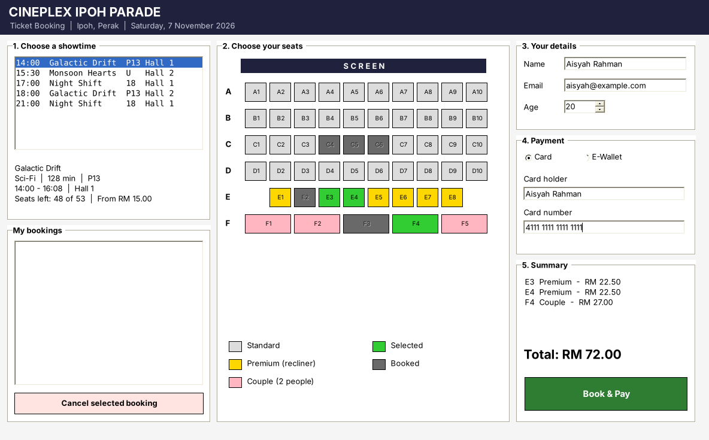
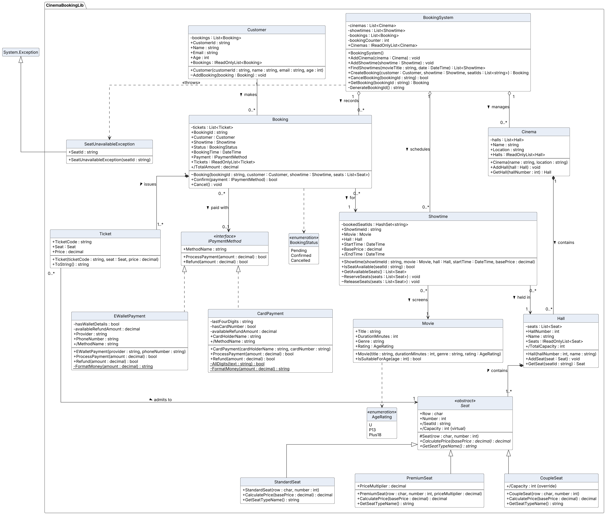

# CinemaBookingLib – Cinema Ticket Booking

OOP group project (TGB1103). **CinemaBookingLib** is a C# class library for booking cinema tickets, like TGV or GSC. **CinemaBookingGUI** is a Windows Forms app that uses the library.



**Demo video:** [YouTube link here]

## Projects

| Folder | What it is |
|---|---|
| `CinemaBookingLib/` | The class library (builds `CinemaBookingLib.dll`) |
| `CinemaBookingGUI/` | WinForms app: choose a showtime, pick seats, pay, cancel |
| `CinemaBookingDemo/` | Console demo from the design stage |
| `docs/` | UML class diagram and screenshot |

## How to run

**Visual Studio 2022:** open `CinemaBooking.sln` and press **F5**. `CinemaBookingGUI` is the startup project.

**VS Code / command line (Windows):**
```
dotnet run --project CinemaBookingGUI
```

Requires the .NET 8 SDK. The GUI runs on Windows only.

## What the app does

1. **Choose a showtime:** five showtimes across two halls, with the movie's genre, length, end time and seats left.
2. **Choose seats:** click seats on the seat map. Standard, Premium (recliner, +50%) and Couple (2 people, 10% off) seats are different colours. Booked seats are grey and cannot be clicked.
3. **Enter details:** name, email and age. Movies rated 18 refuse customers under 18.
4. **Pay:** by card or e-wallet (Touch 'n Go, GrabPay, Boost). If payment fails, the seats are released again.
5. **My bookings:** see your bookings and cancel one. Cancelling refunds the payment and frees the seats.

## OOP concepts used

- **Inheritance:** `StandardSeat`, `PremiumSeat` and `CoupleSeat` inherit from the abstract `Seat` class.
- **Polymorphism:** each seat type overrides `CalculatePrice()`, so the GUI calls the same method and gets the right price for every seat.
- **Interface:** `CardPayment` and `EWalletPayment` implement `IPaymentMethod`, so `Booking.Confirm()` accepts either one.
- **Encapsulation:** private fields, private setters, read-only lists and `internal` methods, so bookings can only be made through `BookingSystem`.
- **Composition:** a `Cinema` has `Hall`s, a `Hall` has `Seat`s, and a `Booking` has `Ticket`s.
- **Exceptions:** `SeatUnavailableException` when a seat is taken, and `InvalidOperationException` for the age limit.

## UML class diagram


